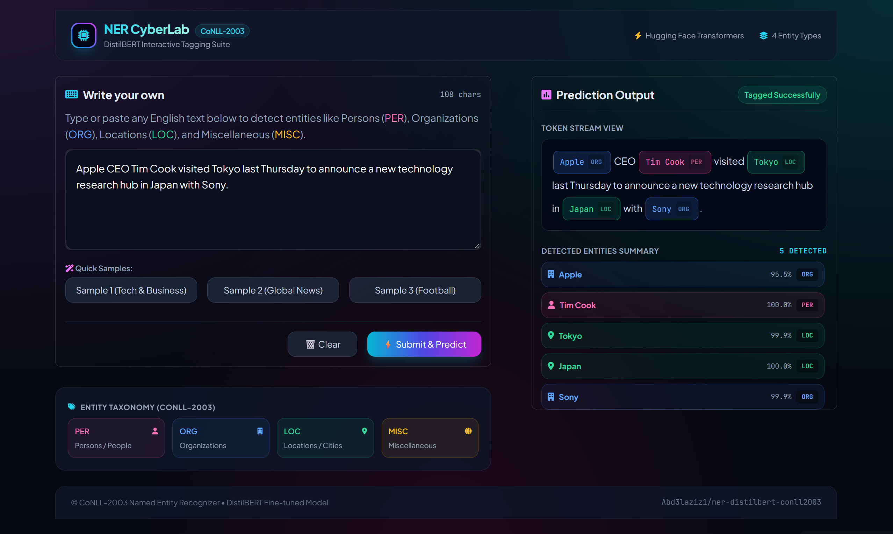
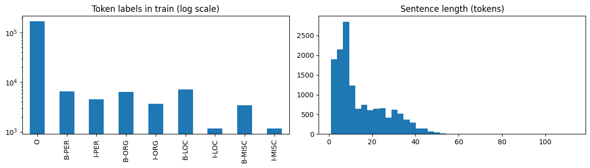
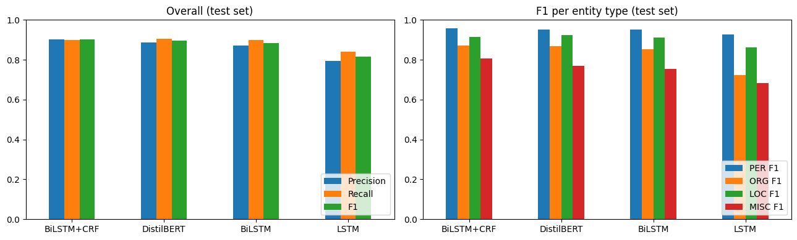
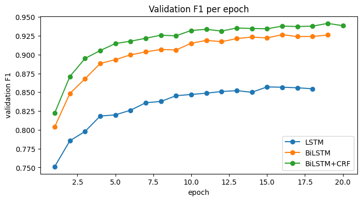

# 🏷️ Named Entity Recognition (NER) on CoNLL-2003


A sequence labeling system that finds **people (PER), organizations (ORG), locations (LOC) and miscellaneous entities (MISC)** in English text. Four models are trained and compared on the same data: **LSTM, BiLSTM and BiLSTM + CRF** (built from scratch in PyTorch with GloVe and character embeddings) and a fine-tuned **DistilBERT**. The fine-tuned DistilBERT is deployed as an interactive **Gradio** app that highlights entities with colors.

> ⚠️ This is a student project and is not a production information extraction system.

---

## 🌐 Links

- 📓 **Training notebook on Kaggle:** [named-entity-recognition](https://www.kaggle.com/code/abdelazizelshourbgy/named-entity-recognition)
- 🚀 **Live demo:** [https://named-entity-recognition0.streamlit.app/](https://named-entity-recognition0.streamlit.app/) 

## 📸 Demo Streamlit


## 📸 Demo Gradio




---

## ✨ Features

- Detects **4 entity types** and highlights each one with its own color
- Shows a table with every detected entity, its type and a confidence score
- Compares 3 models built from scratch and a fine-tuned transformer on the same data
- Entity-level evaluation with **seqeval** (a whole entity counts as correct only if both its boundaries and its type are correct)
- Includes an analysis of where the CRF layer helps

## 🗂️ Dataset

**CoNLL-2003** (Reuters news in English), loaded from Hugging Face ([`eriktks/conll2003`](https://huggingface.co/datasets/eriktks/conll2003), with [`lhoestq/conll2003`](https://huggingface.co/datasets/lhoestq/conll2003) as an automatic fallback because the first one uses a loading script that newer `datasets` versions do not support).

- Split: **14,041 train / 3,250 validation / 3,453 test** sentences
- Labels follow the **IOB2** scheme: `B-X` starts an entity, `I-X` continues it, `O` is not an entity (9 labels in total)
- The dataset has no DATE type, so the four types are PER, ORG, LOC and MISC

| Type | Entities in train | Entities in test |
|---|---|---|
| LOC | 7,140 | 1,668 |
| PER | 6,600 | 1,617 |
| ORG | 6,321 | 1,661 |
| MISC | 3,438 | 702 |

Most tokens (**83.3%**) are `O`, which is why plain token accuracy would be misleading and entity-level metrics are used instead.



## 🧪 Method

| Model | Details |
|---|---|
| LSTM | Reads the sentence left to right only |
| BiLSTM | Reads in both directions |
| BiLSTM + CRF | Same as BiLSTM, with a CRF layer that decodes the best **whole label sequence** and learns which label transitions are legal |
| DistilBERT | `distilbert-base-cased`, fine-tuned for token classification |

**From-scratch models:** input = frozen **GloVe** vector (100d, 400,000 words) concatenated with a **character CNN** vector (30-dim character embeddings, 50 filters, kernel 3) → dropout 0.5 → (Bi)LSTM with 128 units per direction → linear layer over the 9 labels. The character CNN handles words missing from GloVe and recovers capitalization, which GloVe loses because it is lowercase. About 97% of the tokens in train and test are found in GloVe. Training: Adam, learning rate 1e-3, batch 32, gradient clipping, up to 20 epochs with early stopping on validation F1 (patience 3).

**DistilBERT:** the label is given to the first word piece of each word and ignored (`-100`) for the other pieces. Trained for 3 epochs with learning rate 5e-5, batch 16, mixed precision, and the best epoch by validation F1 is kept.

---

## 📊 Results

### Comparison of the four models (test set, 5,648 entities)

Entity-level scores with seqeval (micro-averaged). **F1** is the main metric.

| Model | Precision | Recall | F1 |
|---|---|---|---|
| **BiLSTM + CRF** | **0.903** | 0.899 | **0.901** |
| DistilBERT | 0.886 | **0.905** | 0.895 |
| BiLSTM | 0.872 | 0.898 | 0.885 |
| LSTM | 0.794 | 0.840 | 0.816 |

### F1 per entity type (test set)

| Model | PER | LOC | ORG | MISC |
|---|---|---|---|---|
| BiLSTM + CRF | **0.959** | 0.914 | **0.873** | **0.805** |
| DistilBERT | 0.952 | **0.925** | 0.868 | 0.770 |
| BiLSTM | 0.951 | 0.911 | 0.853 | 0.754 |
| LSTM | 0.927 | 0.861 | 0.724 | 0.683 |



- **Reading direction matters most.** Going from LSTM to BiLSTM adds about **7 F1 points** (0.816 → 0.885), mostly on ORG (+13 points) and MISC, where the words after an entity are needed to decide its type.
- **The CRF adds about 1.6 F1 points** over BiLSTM (0.885 → 0.901) and improves every entity type.
- **BiLSTM + CRF and DistilBERT are very close** (0.901 vs 0.895). Each model was trained once, so this 0.6 point gap should not be read as a real difference. DistilBERT was trained for only 3 epochs (about 2 minutes), and BiLSTM + CRF used all 20 allowed epochs with validation F1 still creeping up, so both are probably not at their best.
- **MISC is the hardest type** for every model, followed by ORG. **PER is the easiest.**



### Where the CRF helps

Plain softmax models choose each label independently, so they can produce illegal sequences such as `O` followed by `I-PER`. Counting these in the test predictions:

| Model | Illegal `I-` tags |
|---|---|
| LSTM | 380 |
| BiLSTM | 122 |
| DistilBERT | 69 |
| **BiLSTM + CRF** | **0** |

In **130 test sentences only the CRF model gets every entity right**, compared with **64 sentences where only the BiLSTM does**. Typical fixes are entities cut in the wrong place (for example `ZIMBABWE OPEN` predicted as `LOC` + `MISC` instead of one `MISC`) and inconsistent labels inside one entity.

---

## 📁 Project structure

```
named-entity-recognition/
├── app.py                          # Gradio
├── streamlit_app.py                # Streamlit
├── named-entity-recognition.ipynb  # training, comparison and evaluation notebook
├── requirements.txt
├── assets/                         # screenshots and charts
├── LICENSE
└── README.md
```

The fine-tuned model (`ner_model/`, about 260 MB) is **not stored in this repository** because of GitHub's file size limit. It is in the files of the [Hugging Face Space](https://huggingface.co/spaces/Abd3laziz1/named-entity-recognition/tree/main/ner_model) <!-- update this link -->, and the Kaggle notebook produces it in `/kaggle/working/ner_model`.

## 🚀 Run locally

```bash
git clone https://github.com/AbdelazizElshourbgy-ui/named-entity-recognition.git
cd named-entity-recognition

python -m venv venv
venv\Scripts\activate        # Windows
# source venv/bin/activate   # macOS / Linux

pip install -r requirements.txt
```

Download the `ner_model/` folder (see above) and put it next to `app.py`, then run:

```bash
python app.py
```

Open the local address printed in the terminal (usually `http://127.0.0.1:7860`), type an English sentence and press **Submit**. The app runs on CPU and uses a GPU automatically if one is available. You can also point to another location with `MODEL_DIR=/path/to/ner_model python app.py`.

## 🔁 Reproduce the training

Open the notebook on Kaggle, turn on a **GPU** and **Internet**, and press **Run All**. GloVe and the dataset are downloaded automatically from Hugging Face. The whole notebook takes roughly 25 minutes (BiLSTM + CRF is the slowest at about 33 seconds per epoch, DistilBERT takes about 2 minutes).

Everything uses PyTorch only, so there is no framework conflict on the GPU.

## ⚠️ Limitations

- Each model was trained once, with no hyperparameter search, so small gaps between models are not reliable.
- BiLSTM + CRF reached the 20-epoch limit while validation F1 was still improving slightly, and DistilBERT was trained for only 3 epochs.
- CoNLL-2003 is Reuters news from 1996, in English only, with just 4 entity types. Results on other kinds of text (social media, other languages, other domains) will be different.
- MISC and ORG entities are the weakest, and the confidence scores are not calibrated probabilities.
- Metrics use seqeval's default (CoNLL-style) matching.

## 🔮 Future work

- Train longer and with several random seeds to measure the variance
- Try larger transformers (BERT-base, RoBERTa) and a CRF layer on top of DistilBERT
- Compare GloVe with FastText embeddings
- Test on text from other domains

## 🛠️ Tech stack

Python · PyTorch · pytorch-crf · HuggingFace Transformers and Datasets · seqeval · gensim (GloVe) · Gradio · Streamlit . Pandas · Matplotlib · Kaggle

## 👤 Author

**Abdelaziz Elshourbgy**

GitHub: [@AbdelazizElshourbgy-ui](https://github.com/AbdelazizElshourbgy-ui) · LinkedIn: [Abdelaziz Elshourbgy](https://www.linkedin.com/in/abdelaziz-elshourbgy-b126a83a2/)

## 📄 License

Code released under the [MIT License](LICENSE). The CoNLL-2003 dataset and the GloVe vectors belong to their original authors; see their pages for their licenses.
